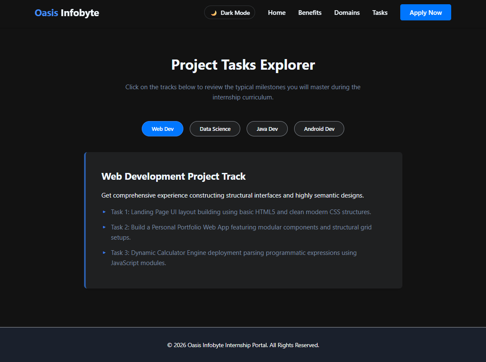

# Oasis Infobyte Internship Portal - Landing Page

A modern, fast, and completely responsive landing page built with semantic HTML5, CSS3 variables, and vanilla JavaScript. This page features an interactive user interface designed to showcase internship tracks, display learning milestones, handle applicant intake, and offer a user-controlled dark theme toggle.

## 🚀 Live Demo
*Link your hosted site here (e.g., GitHub Pages, Vercel, Netlify)*

## ✨ Key Features
- **Modern Responsive Design**: Fluid layouts optimized seamlessly for Mobile, Tablet, and Desktop screens.
- **Dynamic Task Explorer**: Interactive modular tab selectors built to render specific domain syllabus objectives on click.
- **Dynamic Context Modal Form**: Pre-fills corresponding technical domains upon activation from contextual card buttons.
- **Dual Lighting Environment**: Integrated theme state persistence matching structural UI components dynamically to a Light/Dark Mode toggle.
- **Zero Third-party Dependencies**: Built exclusively with core native frontend languages ensuring highly optimal rendering performance.

## 📂 Project Structure
```text
├── index.html   # Main semantic structural layout skeleton
├── style.css    # Clean UI presentation rules utilizing global CSS custom properties
└── script.js    # Clean State tracking management logic and event handshakes
```

## 🛠️ Built With
- **HTML5**: Structured semantic web architecture.
- **CSS3 Variables**: Custom themes with scalable structural flex/grid alignment patterns.
- **JavaScript (ES6+)**: Functional event listener models mapping asynchronous user behaviors.

## 🏁 Getting Started
1. **Clone the repository:**
   ```bash
   git clone https://github.com
   ```
2. **Navigate into the directory:**
   ```bash
   cd oasis-landing-page
   ```
3. **Launch the platform:**
   - Double-click the `index.html` file inside your explorer to run the instance directly inside your default web browser.

## Screenshots
   
   


