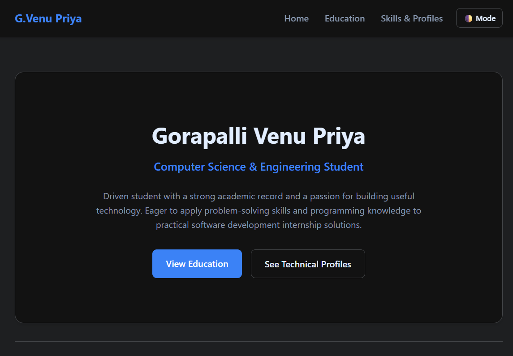

# Developer Portfolio Web Application

A sleek, responsive, single-page web application architecture crafted to exhibit personal academic accomplishments, specialized code assets, functional software applications, and dynamic engagement form endpoints.

## ✨ Key Features
- **Smooth Navigation Traversal**: Employs sleek structural window scroll patterns linked to tracking nav anchors.
- **Filterable Project Matrix**: Dynamic item arrangement filters that showcase targeted tech domains (Web Dev, Data Science, Android) flawlessly.
- **Comprehensive Experience Timeline**: Vertical responsive flow mapping showing career developments, course milestones, and certificates.
- **Validating Feedback Form**: Strict pattern checks for secure email configurations and communication inputs.

## 📂 Project Structure
```text
├── index.html       # Structural layouts containing header, hero, projects, and footer
├── style.css        # Visual alignment structures, custom element metrics, and keyframes
├── script.js        # Form validation schemas, filtering modules, and structural logic
└── assets/          # Shared local storage containing graphic resources, SVGs, and images
```

## 🛠️ Built With
- **HTML5 & CSS3**: Responsive grids, flexible containers, and smooth animation transitions.
- **Vanilla JavaScript**: Programmatic structural array filtering, state tracking, and UI interaction logic.

## 🏁 Getting Started
1. **Clone the repository:**
   ```bash
   git clone https://github.com
   ```
2. **Navigate into the directory:**
   ```bash
   cd my-portfolio
   ```
3. **Launch the project:**
   - Open `index.html` inside any standard web browser to evaluate layout functionality locally.

  ## Screenshots
  
